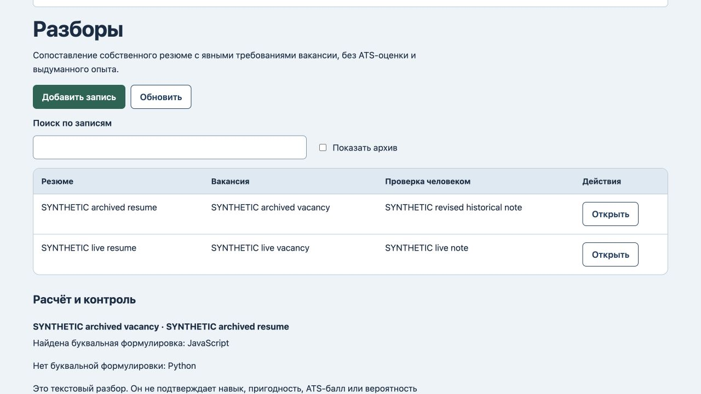
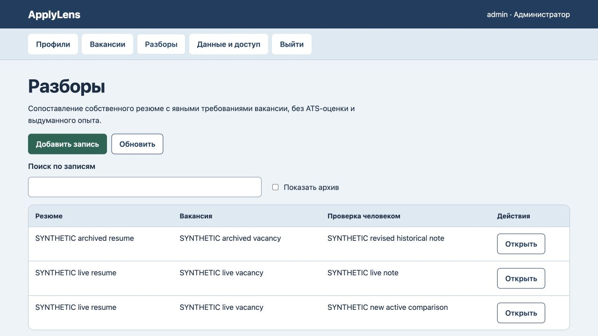

# ApplyLens: архивные источники и сохранение разбора

25 октября 2026. На прежнем коде новый разбор принимал архивные резюме и вакансию: количество разборов увеличивалось с1 до2. В форме уже существующего разбора архивные источники отсутствовали, оба обязательных выбора становились пустыми. Сам текстовый расчёт после архивирования уже сохранялся — это не новый дефект. Две регрессии сначала завершились ошибкой.

Теперь новый разбор и смена ссылки требуют действующего источника. Прежняя неизменённая архивная ссылка сохраняется; можно изменить примечание, прочитать историю, архивировать разбор или восстановить копию. Форма редактирования показывает текущий архивный вариант с пометкой «Архив», новая форма предлагает только действующие источники. Явная смена ссылки на действующий источник остаётся доступна.

Прошли6 тестов, включая файловый перезапуск и восстановление. Отдельно6 авторизованных HTTP-запросов на создание и смену ссылок отклонены со статусом400, все данные/версия8/журнал8 неизменны. В браузере примечание прежнего разбора сохранено с теми же архивными ссылками; новый допустимый разбор создан на действующих данных. Повторное чтение подтверждает3 разбора, исходные тексты и2 прежних расчёта неизменны, версия10/журнал10. [Машинная проверка](archive-verification.json).

Это буквальное сопоставление фраз, не ATS-рейтинг, решение о найме или подтверждение навыка. Результат по-прежнему рассчитывается по текущим текстам связанных записей: правка действующего источника или явная смена ссылки может его изменить. Неизменные снимки версий не добавлялись, старые разборы не удалялись и автоматически не исправлялись. Изменено только сохранение вариантов в форме; схема данных прежняя. Полный новый аудит интерфейса и безопасности не проводился, промышленное размещение не заявлено.
